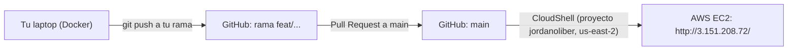

# Guía del Equipo — LATINEX Cloud (Concurso 2026-II)

> **Léelo antes de programar.** Aquí está todo lo que necesitas para trabajar en tu parte sin romper lo que ya funciona en producción.

| Dato | Valor |
| :--- | :--- |
| **Demo en vivo (AWS EC2, IP fija)** | http://3.151.208.72/ |
| **Repositorio** | https://github.com/JordanSoncco/latinex (rama **`main`**) |
| **Exposición** | Viernes 27 de noviembre de 2026 |
| **Líder / servidor AWS** | Jordan Soncco (944967995) |
| **Frente 2 — PDF nativo** | William Dominic Tito (`wdominic6`, 949769189) |
| **Frente 3 — IDE y QA** | Jamiel Mendoza (926767014) |

---

## 1. Qué ya está hecho y funcionando

- **Compilador Frente 1 (Jordan):** Léxico (78 tokens), Sintáctico (autómata de 22 estados con pila) y Semántico (errores `1500`–`1707`). Pruebas: `25/25` léxico, `31/31` válidos + `20/20` negativos.
- **Plataforma tipo Overleaf:** registro e inicio de sesión de usuarios, máximo **10 documentos `.ltx`** y **5 imágenes `.jpg`** por documento, Modo Invitado, editor con números de línea, vista previa A4 y cajón inferior con las **4 fases** del compilador.
- **Stack moderno en Docker:** PHP **8.5** + PostgreSQL **17** + Caddy **2**.
- **Servidor en AWS EC2** (`t4g.small`, `us-east-2`) con IP fija `3.151.208.72`.
- **Pendiente:** el botón **Descargar PDF** sigue desactivado hasta que el Frente 2 genere el `%PDF-1.4` nativo.

---

## 2. Reglas de oro (para no pisarnos)

1. **Nunca hagas `git push` directo a `main`.** Trabaja en tu rama y avisa a Jordan para integrarla.
2. **Solo modifica tus archivos asignados** (sección 4). Si necesitas cambiar un archivo de otro frente, avisa primero por el grupo.
3. **No se accede por SSH al servidor.** El servidor se actualiza solo desde GitHub; así nadie rompe la demo en vivo.
4. **Antes de subir, corre las pruebas** (sección 5). Si alguna falla, no la subas.
5. **Nunca subas el archivo `.env`** (ya está en `.gitignore`).

---

## 3. Preparar tu laptop (una sola vez)

**Requisitos:** Git y **Docker Desktop** abierto. No necesitas instalar PHP.

1. Acepta la invitación de colaborador que te llegó por correo o en https://github.com/JordanSoncco/latinex/invitations (sin esto GitHub te devuelve **error 403** al hacer `push`).
2. Clona el proyecto y crea tu rama:

```bash
git clone -b main https://github.com/JordanSoncco/latinex.git
cd latinex
cp .env.example .env
docker compose up -d --build
```

3. Abre http://localhost:8080/ y verifica que carga el editor.

**Ya habías clonado antes y te salió 403?** No vuelvas a clonar. Solo acepta la invitación y ejecuta:

```bash
git fetch origin
git checkout main
git pull origin main
```

---

## 4. Qué le toca a cada uno

### William Dominic — Frente 2 (rama `feat/frente2-ejecutor-pdf`)

```bash
git checkout -b feat/frente2-ejecutor-pdf
```

**Archivos exclusivos:** `src/Ejecutor.php`, `src/PdfGenerator.php`, `test_pdf.php` (nuevo).

**Objetivo:** que al compilar se genere un **PDF real** sin librerías externas (nada de FPDF/TCPDF).

1. **`Ejecutor.php` — Pasada 1 (layout):** recorrer los tokens y calcular la posición de cada elemento en hojas A4 (`595 × 842 pt`): títulos, secciones, párrafos, listas, tablas, fracciones, ecuaciones, cajas, imágenes, `#indicegeneral` y `#referencia`. Saltar de página cuando `Y > 792 pt`.
2. **`PdfGenerator.php` — Pasada 2 (binario):** convertir esos elementos en un archivo `%PDF-1.4` con objetos `/Catalog`, `/Pages`, `/Page`, `/Font`, contenido (`BT`, `Tf`, `Td`, `Tj`), vectores para `#caja`, imágenes JPEG con `/DCTDecode`, tabla `xref` y `trailer`.
3. Cuando el PDF esté listo, cambia `isImplemented()` para que devuelva **`true`**. Con eso, el visor muestra el PDF y se activa **Descargar PDF** automáticamente (no tienes que tocar la interfaz).

**Contratos que NO debes cambiar** (la API y la interfaz dependen de ellos):

```php
// Ejecutor
public function __construct(Tokenizador $tokenizador, ?TablaSimbolos $tablaSimbolos = null, string $assetsDir = '')
public function Ejecutar(): bool
public function getElementos(): array
public function getMetadatos(): array
public function getResumen(): array   // {implementado, estado, totalPaginas, totalElementos, metadatos}
public function getError(): ?array

// PdfGenerator
public function __construct(array $elementos = [], array $metadatos = [], string $assetsDir = '')
public function isImplemented(): bool
public function generate(): string    // binario %PDF-1.4 completo
public function getStats(): array     // {implementado, paginas, bytes, objetosPdf}
```

**Nota técnica:** el `Tokenizador` omite el espacio que va justo después de `}` (ej.: `m#superindice{2} y`). Para recuperar los espacios, usa `Token::$linea` y `Token::$columna`, o pide a Jordan un flag opcional en el `Tokenizador`.

### Jamiel — Frente 3 (rama `feat/frente3-ide-qa`)

```bash
git checkout -b feat/frente3-ide-qa
```

**Archivos exclusivos:** `public/index.html`, `public/styles.css`, `public/app.js`, `test_e2e.php` (nuevo), diapositivas y evidencias en Drive.

1. Pulir la experiencia tipo Overleaf (textos, ayudas visuales, comportamiento en pantallas pequeñas).
2. Probar en http://3.151.208.72/ los **29 casos** del selector y los ejemplos de error; anotar cualquier caso que falle.
3. Probar los flujos de usuario: registro, inicio de sesión, crear hasta 10 documentos (el 11 debe bloquearse), subir `.jpg` y Modo Invitado.
4. Capturas de pantalla para Drive y diapositivas de la exposición.

### Jordan — Líder (Frente 1 + servidor)

- Revisar e integrar las ramas de William y Jamiel en `main`.
- Actualizar el servidor AWS (sección 6) y verificar http://3.151.208.72/.

---

## 5. Pruebas obligatorias antes de subir

```bash
docker compose exec -T app php test_lexico.php
docker compose exec -T app php test_frente1.php
docker compose exec -T app php test_auth_proyectos.php
```

Las tres deben terminar en **100% APROBADO**. William: agrega también `test_pdf.php` y verifica que el PDF abra en Chrome/Edge.

---

## 6. Cómo publicar tus cambios en el servidor (`http://3.151.208.72/`)



1. **Sube tu rama a GitHub:**

```bash
git add -A
git commit -m "feat(pdf): describir brevemente el cambio"
git push -u origin feat/frente2-ejecutor-pdf   # o feat/frente3-ide-qa
```

2. Abre un **Pull Request** hacia `main` en GitHub y haz *merge* (previa coordinación en el grupo).
3. **Publicar en el servidor (cualquier miembro del equipo, sin SSH):**
   - Acepta la invitación que Jordan envió a tu correo desde **AWS Settings** (https://settings.aws.com/) para el proyecto **`jordanoliber`**.
   - Abre la **AWS Management Console**, verifica arriba a la derecha la región **`us-east-2` (Ohio)** y pulsa el ícono **`>_` (CloudShell)**.
   - Pega este único comando:

```bash
rm -rf /tmp/latinex && git clone --depth 1 -b main https://github.com/JordanSoncco/latinex.git /tmp/latinex && bash /tmp/latinex/deploy/update-ec2-cloudshell.sh
```

En **~30–60 segundos** la instancia EC2 descargará `main`, reconstruirá Docker y verás tus cambios en vivo en http://3.151.208.72/.

---

## 7. Problemas comunes

| Problema | Solución |
| :--- | :--- |
| `error: 403` / `Permission denied` al hacer `push` | Aceptar la invitación de colaborador en https://github.com/JordanSoncco/latinex/invitations |
| `failed to connect to the docker API` | Abrir Docker Desktop y esperar a que diga *Running* |
| El puerto 8080 está ocupado | Cambiar `HTTP_PORT=8081` en `.env` y abrir http://localhost:8081/ |
| `docker compose up --build` tarda o se cuelga | Ya usamos `serversideup/php:8.5-fpm-alpine` (trae todo instalado). Ejecutar `docker compose down` y volver a intentar |
| No ves los últimos cambios | `git checkout main && git pull origin main` antes de crear tu rama |

---

## 8. Al terminar el concurso (solo Jordan)

Para no gastar el crédito de AWS, liberar la IP fija y apagar el servidor desde CloudShell:

```bash
bash /tmp/latinex/deploy/cleanup-cloudshell.sh
```
