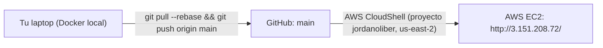

# Guía del Equipo — LATINEX Cloud (Concurso 2026-II)

> **Léelo antes de programar.** Aquí está todo el contexto técnico, los contratos exactos del código y los comandos para que **cualquier integrante** pruebe en su laptop y publique directamente en el servidor AWS sin depender de Jordan ni usar SSH.

| Dato | Valor |
| :--- | :--- |
| **Demo en vivo (AWS EC2, IP fija)** | http://3.151.208.72/ |
| **Repositorio GitHub** | https://github.com/JordanSoncco/latinex (rama única de trabajo: **`main`**) |
| **Proyecto AWS (Región seleccionada)** | **`jordanoliber`** en **`us-east-2` (Ohio)** — acceso vía https://settings.aws.com/ |
| **Exposición oficial** | Viernes 27 de noviembre de 2026 |
| **Frente 1 + Servidor (Líder)** | Jordan Soncco (`JordanSoncco`, 944967995) |
| **Frente 2 — Layout y `%PDF-1.4` nativo** | William Dominic Tito (`wdominic6` / `domntmg`, 949769189) |
| **Frente 3 — IDE Overleaf y QA** | Jamiel Mendoza (`yamilmcc`, 926767014) |

---

## 1. Qué ya está hecho y funcionando

- **Compilador Frente 1 (Jordan):** Analizador Léxico (78 tokens), Sintáctico (autómata con pila de 22 estados `0–21`) y Semántico (`TablaSimbolos` + códigos de error `1500`–`1707`). Verificado al 100%: `25/25` léxico, `31/31` casos válidos + `20/20` casos negativos.
- **Plataforma Cloud estilo Overleaf:** registro e inicio de sesión (`Argon2id` + CSRF), persistencia en **PostgreSQL 17** con tope atómico de **10 documentos `.ltx`** (máx. 64 KB c/u) y **5 imágenes `.jpg`** (máx. 2 MB c/u) por usuario, Modo Invitado instantáneo, barra visual de inserción rápida, editor con líneas, vista previa A4 y cajón inferior plegable con las **4 fases** del compilador.
- **Entorno Docker actualizado:** `serversideup/php:8.5-fpm-alpine` (**PHP 8.5.13** con `pdo_pgsql` y `OPcache` precompilados) + `postgres:17-alpine` + `caddy:2.9-alpine`.
- **Servidor AWS EC2 operativo:** instancia `t4g.small` (`i-08a0dd1c559d0abe0`) en `us-east-2` con IP estática **`3.151.208.72`** y administración segura por **SSM** (puerto `22` cerrado).
- **Qué falta para la versión final:** completar **Frente 2** (`Ejecutor.php` y `PdfGenerator.php`) para que el visor muestre el `%PDF-1.4` nativo real y se active el botón **Descargar PDF**, más el pulido/QA y diapositivas de **Frente 3**.

---

## 2. Reglas de oro (trabajo directo en `main` sin conflictos)

Trabajamos **directamente sobre `main`** para ir rápido hasta la exposición. Como cada integrante tiene archivos exclusivos, solo hay que respetar estas 5 reglas:

1. **Solo modifica tus archivos asignados** (sección 4). Si necesitas tocar un archivo de otro frente, coordínalo antes por WhatsApp.
2. **Siempre haz `git pull --rebase origin main` antes de empezar y antes de hacer `git push origin main`.**
3. **Corre las pruebas locales antes de subir** (sección 5). Si alguna falla o hay error de sintaxis PHP, corrígelo antes de hacer `push` para no tumbar http://3.151.208.72/.
4. **No uses SSH ni abras el puerto `22` en AWS.** Para reflejar tus cambios en la web usa **AWS CloudShell** (sección 6); tarda ~30 segundos.
5. **Nunca subas el archivo `.env`** ni carpetas `storage/` o `temp_uploads/` (ya están ignorados en `.gitignore`).

---

## 3. Preparar tu laptop (una sola vez)

**Requisitos:** Git y **Docker Desktop** abierto (en estado *Running*). No necesitas instalar PHP ni PostgreSQL en tu PC.

### A. Aceptar tus invitaciones (GitHub y AWS)
1. **GitHub:** si te salió error `403`, acepta la invitación de colaborador en https://github.com/JordanSoncco/latinex/invitations (Dominic: para `wdominic6`; Jamiel: ya está activo como `yamilmcc`).
2. **AWS Settings:** acepta la invitación que Jordan envió a tu correo (`willdomtm@gmail.com` / `jamielmendoza@gmail.com`) entrando a **AWS Settings** (https://settings.aws.com/) para acceder como **miembro del equipo** al proyecto **`jordanoliber`**.

### B. Clonar y levantar Docker local
```bash
git clone https://github.com/JordanSoncco/latinex.git
cd latinex
cp .env.example .env
docker compose up -d --build
```
Abre **http://localhost:8080/** en tu navegador y confirma que carga LATINEX Cloud.

*(Si ya habías clonado el repo antes, no lo borres; solo actualízalo a `main`:)*
```bash
git fetch origin
git checkout main
git pull --rebase origin main
```

> **Nota sobre cambios en vivo en Docker local:** las carpetas `src/`, `public/` y `api.php` están montadas en tiempo real; cualquier cambio en esos archivos se ve al recargar http://localhost:8080/ sin reconstruir. Solo necesitas volver a correr `docker compose up -d --build` si agregas un archivo nuevo en la raíz (como `test_pdf.php`).

---

## 4. Qué le toca a cada integrante

### William Dominic — Frente 2 (Backend Two-Pass y `%PDF-1.4` nativo)

**Archivos exclusivos:** `src/Ejecutor.php`, `src/PdfGenerator.php` y `test_pdf.php` (opcional).

**Objetivo:** que al compilar se genere un **PDF real `%PDF-1.4`** sin librerías externas (prohibido FPDF/TCPDF).

1. **`src/Ejecutor.php` (Pasada 1 — Layout geométrico A4):**
   - Recorrer los tokens de `$this->tokenizador` y resolver macros (`#definir`/`#imprimir`), `TablaSimbolos`, pila de estilos (`StyleStack`: `/F1` Helvetica, `/F2` Bold, `/F3` Oblique, `/F5` Courier y colores RGB `0..1`), anchos AFM + *word wrap*, alineación (`izquierda`, `centro`, `derecha`, `justificado` con `Tw`), listas, tablas (`#tabla`/`#fila`/`#celda`), fracciones, ecuaciones, cajas, imágenes `.jpg` desde `$this->assetsDir`, `#indicegeneral`, `#referencia` y salto de página automático (`A4: 595 × 842 pt`, margen superior `50`, inferior `792`).
   - Guardar el resultado estructurado en `$this->elementos`, metadatos en `$this->metadatos` y cambiar **`'implementado' => true`** dentro de `getResumen()`.
2. **`src/PdfGenerator.php` (Pasada 2 — Emisor binario `%PDF-1.4`):**
   - Emitir objetos `/Catalog`, `/Pages`, `/Page`, `/Font` (`Type1` `WinAnsiEncoding`), `/Info`, imágenes `/XObject /Image /DCTDecode`, operadores PostScript (`BT`, `ET`, `Tf`, `Td`, `Tj`, `Tw`, `rg`, `RG`, `re`, `m`, `l`, `h`, `S`, `f`) con eje invertido `Y_pdf = 842 - Y_logica`, tabla `xref` y `trailer`.
   - Cambiar **`isImplemented()`** para que devuelva **`true`**.
   - **Importante:** `api.php` activa el visor PDF y el botón **Descargar PDF** automáticamente cuando **ambos** (`PdfGenerator::isImplemented()` y `Ejecutor::getResumen()['implementado']`) devuelven `true` y `generate()` retorna el binario `%PDF-1.4` no vacío. No necesitas tocar `api.php` ni `public/`.

**Contratos exactos que NO debes romper (namespace `Latinex`):**

```php
// src/Ejecutor.php
public function __construct(Tokenizador $tokenizador, ?TablaSimbolos $tablaSimbolos = null, string $assetsDir = '')
public function Ejecutar(): bool
public function getElementos(): array
public function getTablaSimbolos(): TablaSimbolos
public function getError(): ?array
public function getMetadatos(): array
public function getResumen(): array   // ['implementado' => true, 'estado' => ..., 'totalPaginas' => ..., 'totalElementos' => ..., 'metadatos' => ...]

// src/PdfGenerator.php
public function __construct(array $elementos = [], array $metadatos = [], string $assetsDir = '')
public function isImplemented(): bool // devolver true cuando generate() emita %PDF-1.4 válido
public function generate(): string    // binario %PDF-1.4 completo
public function getStats(): array     // ['implementado' => bool, 'paginas' => int, 'bytes' => int, 'objetosPdf' => int]
```

**Nota técnica sobre espacios tras `}`:** `Tokenizador` omite espacios justo después de `}` en expresiones inline (ej. `m#superindice{2} y`). Para reconstruir el espaciado exacto usa `Token::$linea` y `Token::$columna` junto a `mb_strlen` del lexema anterior sin romper `test_lexico.php` ni `test_frente1.php`.

---

### Jamiel — Frente 3 (IDE Web estilo Overleaf, QA y Exposición)

**Archivos exclusivos:** `public/index.html`, `public/styles.css`, `public/app.js`, evidencias en Drive y diapositivas.

1. Pulir la experiencia visual tipo Overleaf (claridad de botones, textos, comportamiento en pantallas medianas y selector de los 29 casos).
2. Validar en http://3.151.208.72/ los **29 casos oficiales** + ejemplos de error léxico, sintáctico y semántico (`1500`–`1707`) verificando el inspector de 4 fases y la descarga del PDF apenas William suba Frente 2.
3. Validar el flujo de usuarios: registro, inicio de sesión, creación hasta **10 archivos `.ltx`** (confirmando bloqueo del #11), subida de imágenes `.jpg` (máx. 5) y Modo Invitado.
4. Subir capturas finales, PDFs generados y diapositivas a la carpeta pública de evidencias del concurso en Drive.

---

### Jordan — Frente 1 y Coordinación

- Mantener estables el Frontend del compilador (`TablaLexica`, `Tokenizador`, `AnalizadorSintactico`, `TablaSimbolos`, `AnalizadorSemantico`), la API (`api.php`, `auth.php`, `projects.php`) y la infraestructura Docker/AWS.
- Apoyar integración final antes del viernes 27 y ejecutar la limpieza de AWS tras la exposición.

---

## 5. Pruebas obligatorias antes de subir a `main`

Ejecuta estos comandos en tu laptop dentro de `latinex/`:

```bash
docker compose exec -T app php -l src/Ejecutor.php
docker compose exec -T app php -l src/PdfGenerator.php
docker compose exec -T app php test_lexico.php
docker compose exec -T app php test_frente1.php
docker compose exec -T app php test_auth_proyectos.php
```

**Criterio de aprobación:** `0` errores de sintaxis y las tres suites en **100% APROBADO**. Si modificaste `public/app.js`, verifica también `node --check public/app.js` (o abre http://localhost:8080/ sin errores en consola F12).

---

## 6. Subir a `main` y reflejar tus cambios en vivo en AWS (sin depender de Jordan)



### Paso 1 — Subir tus cambios a `main`
```bash
git pull --rebase origin main
git add -A
git commit -m "feat(pdf): describir brevemente el cambio"
git push origin main
```

### Paso 2 — Actualizar el servidor AWS en 1 comando (lo puede hacer cualquiera de los 3)
1. Entra a **AWS Settings** (https://settings.aws.com/) → selecciona el proyecto **`jordanoliber`** → abre la **AWS Management Console**.
2. Confirma arriba a la derecha que estás en la región seleccionada **`us-east-2` (Ohio)** y abre el ícono **`>_` (CloudShell)**.
3. Pega este comando único:

```bash
rm -rf /tmp/latinex && git clone --depth 1 -b main https://github.com/JordanSoncco/latinex.git /tmp/latinex && bash /tmp/latinex/deploy/update-ec2-cloudshell.sh
```

En **~30–60 segundos** verás la tabla `docker compose ps` y la respuesta JSON de verificación. Recarga **http://3.151.208.72/** (con `Ctrl+Shift+R` si cambiaste CSS/JS) y tus cambios ya estarán en vivo.

---

## 7. Problemas comunes

| Problema | Solución |
| :--- | :--- |
| `error: 403` / `Permission denied` al hacer `git push` | Acepta la invitación en https://github.com/JordanSoncco/latinex/invitations y verifica qué usuario tienes en Git (`git config user.name`) |
| `rejected (fetch first)` al hacer `git push origin main` | Alguien subió un commit antes que tú; ejecuta `git pull --rebase origin main` y vuelve a hacer `git push origin main` |
| `failed to connect to the docker API` | Abre **Docker Desktop** y espera a que el indicador inferior esté en verde (*Running*) |
| El puerto `8080` está ocupado en tu laptop | Cambia `HTTP_PORT=8081` en tu `.env` local, ejecuta `docker compose up -d` y entra a http://localhost:8081/ |
| Creaste `test_pdf.php` y Docker dice *Could not open input file* | Ejecuta `docker compose up -d --build` para copiar archivos nuevos de la raíz dentro del contenedor `app` |
| No aparece tu cambio de `public/app.js` o `styles.css` en la web | Haz recarga forzada en el navegador (`Ctrl+Shift+R`) |

---

## 8. Al terminar el concurso (solo Jordan)

Para proteger el crédito promocional de AWS (revisable en **AWS Settings > Billing**), liberar la Elastic IP `3.151.208.72` y terminar la instancia EC2 `i-08a0dd1c559d0abe0` desde CloudShell (`us-east-2`):

```bash
rm -rf /tmp/latinex && git clone --depth 1 -b main https://github.com/JordanSoncco/latinex.git /tmp/latinex && bash /tmp/latinex/deploy/cleanup-cloudshell.sh
```
